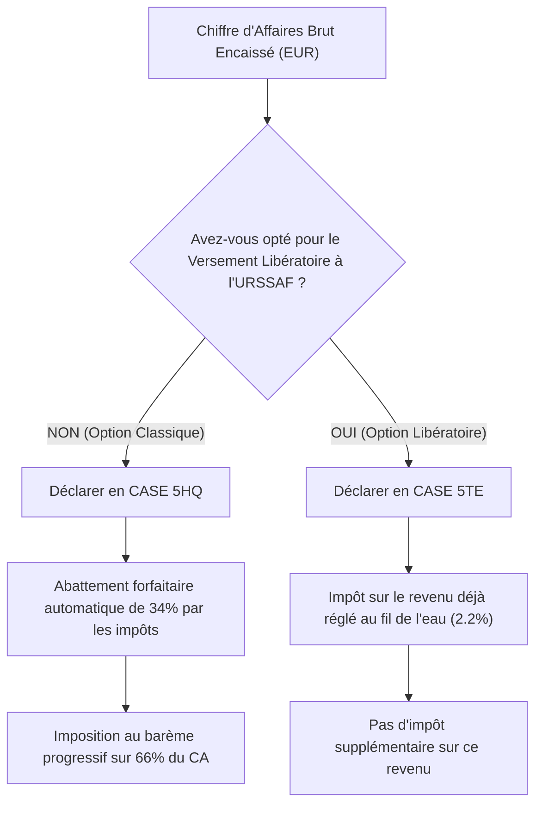

# 🌐 Guide Global de Déploiement & Gestion Fiscale Micro-Entreprise (BNC)
## Global Compatibility Matrix Agent

---

## 📑 Sommaire
1. [Introduction & Architecture du Projet](#1-introduction--architecture-du-projet)
2. [Déploiement Gratuit sur GitHub Pages & Configuration GitHub Actions](#2-déploiement-gratuit-sur-github-pages--configuration-github-actions)
3. [Génération Universelle Gemini 2.5 Flash (8 Langues en 1 Appel)](#3-génération-universelle-gemini-25-flash-8-langues-en-1-appel)
4. [Routeur Mondial Amazon "Zéro Erreur 404" & Détection Client](#4-routeur-mondial-amazon-zéro-erreur-404--détection-client)
5. [SEO International (`hreflang`) & GEO pour Agents IA (`llms.txt`)](#5-seo-international-hreflang--geo-pour-agents-ia-llmstxt)
6. [Mégaphone IA Mondial (Telegraph, README, IndexNow, Archive.org)](#6-mégaphone-ia-mondial-telegraph-readme-indexnow-archiveorg)
7. [Guide Fiscal & Comptable Micro-Entreprise (BNC - Amazon Partenaires)](#7-guide-fiscal--comptable-micro-entreprise-bnc---amazon-partenaires)

---

## 1. Introduction & Architecture du Projet

`global-compatibility-matrix-agent` est une plateforme autonome conçue pour résoudre l'un des problèmes les plus récurrents et rentables du commerce mondial : **l'incertitude sur les dimensions et compatibilités exactes**.

### Les 3 Piliers Thématiques
1. **Compagnies Aériennes Internationales :** Gabarits stricts sous le siège (Personal Item gratuit), valises cabine overhead (10 kg), transport d'animaux en cabine, et restrictions strictes sur les batteries externes lithium (limite légale < 100 Wh).
2. **Hardware, Écrans & Supports VESA :** Normes VESA (200x200, 300x200, 400x400 mm), taille et longueur exacte des pas de vis métriques (M4, M6, M8), dégagement pour barres de son, compatibilité SSD M.2 (2230 vs 2280) et puissances de charge USB-C Power Delivery.
3. **Équipements Automobiles par Modèle Mondial :** Longueur en millimètres et pouces des balises d'essuie-glaces (Conducteur + Passager + Arrière) avec leur type de connecteur (Pinch Tab, Top Lock, J-Hook), charge dynamique maximale sur toit vitré/panoramique, dimensions de protection du coffre et passage des chaînes à neige.

### Arborescence du Projet
```text
global-compatibility-matrix-agent/
├── .env.example                          # Modèle des variables d'environnement & tags Amazon
├── requirements.txt                      # google-genai, jinja2, requests
├── GUIDE_GLOBAL_ET_IMPOTS.md             # Le présent guide exhaustif
├── README.md                             # Annuaire mondial multilingue auto-généré
├── .github/
│   └── workflows/
│       └── autopilot.yml                 # Automatisation autonome toutes les 6 heures
├── data/
│   └── global_matrix_state.json          # Mémoire des matrices, backlog & tokens d'API
├── templates/
│   ├── base.html                         # Base HTML5 avec hreflang, bandeau affiliation et router JS
│   ├── matrix_page.html                  # Fiche produit détaillée avec switch Métrique/Impérial
│   ├── index_lang.html                   # Accueil par langue avec moteur de recherche instantané
│   ├── global_portal.html                # Portail racine / sélecteur mondial de continents
│   └── mentions_legales.html             # Mentions légales Micro-BNC, RGPD et Amazon
├── docs/                                 # Dossier public servi par GitHub Pages
│   ├── index.html                        # Portail racine mondial
│   ├── sitemap.xml                       # Index XML complet avec liaisons hreflang croisées
│   ├── robots.txt                        # Autorisation des bots IA (GPTBot, ClaudeBot, etc.)
│   ├── llms.txt                          # Index synthétique standardisé pour Agents IA
│   ├── llms-full.txt                     # Base textuelle complète pour les LLM
│   ├── <indexnow_key>.txt                # Fichier de validation du protocole IndexNow
│   ├── api/v1/global-catalog.json        # Endpoint API JSON ouvert
│   ├── .well-known/openapi.json          # Spécification OpenAPI 3.1
│   ├── en/ ...                           # Version anglophone (US, UK, CA, AU)
│   ├── de/ ...                           # Version germanophone (DE, AT, CH)
│   ├── fr/ ...                           # Version francophone (FR, BE, CH, CA)
│   ├── es/ ...                           # Version hispanophone (ES, MX, US, LATAM)
│   ├── it/ ...                           # Version italienne (IT, CH)
│   ├── ja/ ...                           # Version japonaise (JP)
│   ├── pt/ ...                           # Version portugaise (BR, PT)
│   └── nl/ ...                           # Version néerlandaise (NL, BE)
├── compta_impots/                        # Module privé de comptabilité & fiscalité
│   ├── livre_des_recettes_officiel.csv   # Journal chronologique officiel des encaissements
│   └── tableau_de_bord_fiscal.html       # Dashboard interactif URSSAF & Impôts 2042-C-PRO
└── src/
    ├── __init__.py
    ├── agent_engine.py                   # Générateur universel 8 langues en 1 appel Gemini
    ├── amazon_global_router.py           # Routeur d'affiliation multi-pays sans erreur 404
    ├── ai_broadcaster.py                 # Mégaphone gratuit (Telegraph, README, IndexNow)
    └── compta_manager.py                 # Gestionnaire fiscal Micro-BNC (5HQ / 5TE)
```

---

## 2. Déploiement Gratuit sur GitHub Pages & Configuration GitHub Actions

Le déploiement est 100% gratuit à vie et ne nécessite aucun serveur payant :

### Étape 1 : Activer GitHub Pages
1. Rendez-vous sur votre dépôt GitHub : `https://github.com/<votre-nom>/global-compatibility-matrix-agent`.
2. Cliquez sur l'onglet **Settings** > **Pages** (dans le menu de gauche).
3. Dans la section **Build and deployment** :
   - **Source :** Sélectionnez `Deploy from a branch`.
   - **Branch :** Sélectionnez `main` et le dossier `/docs`.
   - Cliquez sur **Save**.
4. En moins de 60 secondes, votre site est accessible publiquement sur :
   `https://<votre-nom>.github.io/global-compatibility-matrix-agent/`

### Étape 2 : Configurer les Secrets GitHub Actions
1. Dans votre dépôt GitHub, allez dans **Settings** > **Secrets and variables** > **Actions**.
2. Cliquez sur **New repository secret** et ajoutez :
   - `GEMINI_API_KEY` : Votre clé d'API Google AI Studio (gratuite).
   - `AMAZON_PARTNER_TAG` : Votre identifiant Amazon Partenaires principal (ex: `autocompat-21`).
   - *(Optionnel)* `AMAZON_TAG_UK`, `AMAZON_TAG_DE`, `AMAZON_TAG_ES`, `AMAZON_TAG_IT`, `AMAZON_TAG_CA`, `AMAZON_TAG_JP`, `AMAZON_TAG_AU` si vous possédez des comptes affiliés distincts selon les pays.

### Étape 3 : Fonctionnement du Cron Autopilot (Toutes les 6 Heures)
Le fichier `.github/workflows/autopilot.yml` s'exécute automatiquement toutes les 6 heures (`cron: '0 */6 * * *'`).
À chaque passage :
1. Il sélectionne un nouveau sujet inexploré dans `data/global_matrix_state.json`.
2. Il effectue **1 seul appel JSON** à Gemini 2.5 Flash pour générer la double mesure Métrique/Impériale et les 8 langues.
3. Il met à jour tous les fichiers statiques dans `docs/`.
4. Il diffuse la nouvelle fiche sur Telegraph, met à jour le `README.md` et notifie IndexNow.
5. Il commite et pousse automatiquement les modifications sur `main`. GitHub Pages re-déploie instantanément la nouvelle version.

---

## 3. Génération Universelle Gemini 2.5 Flash (8 Langues en 1 Appel)

Pour respecter à 100% le quota gratuit de l'API Google Gemini tout en évitant les surcoûts d'appels multiples, `src/agent_engine.py` utilise une architecture structurée en **un seul appel JSON** :

### Les Directives du Prompt Structuré
- **Dualité Système Métrique & Impérial Obligatoire :** Chaque rangée de spécifications techniques combine systématiquement les deux systèmes (ex: `40 x 20 x 25 cm (15.7 x 7.8 x 9.8 in)` ou `650 mm (26") + 475 mm (19")`).
- **Traduction Native 8 Langues :**
  - Anglais (`en`) : US, UK, Canada, Australie.
  - Allemand (`de`) : Allemagne, Autriche, Suisse alémanique.
  - Français (`fr`) : France, Belgique, Canada francophone.
  - Espagnol (`es`) : Espagne, Mexique, Amérique Latine, communauté hispanophone US.
  - Italien (`it`) : Italie, Suisse italienne.
  - Japonais (`ja`) : Japon.
  - Portugais (`pt`) : Brésil, Portugal.
  - Néerlandais (`nl`) : Pays-Bas, Flandre.
- **Requêtes de Recherche Amazon Localisées (`amazon_search_query`) :**
  Au lieu de traduire bêtement un mot-clé anglais, Gemini génère la requête d'achat la plus employée par les locaux (ex: `sac cabine ryanair 40x20x25 sous le siege` en FR, `Ryanair Handgepäck Tasche 40x20x25` en DE, `mochila cabina ryanair 40x20x25 bajo asiento` en ES).

---

## 4. Routeur Mondial Amazon "Zéro Erreur 404" & Détection Client

Le taux d'abandon lors d'un achat international est principalement causé par deux erreurs :
1. L'envoi d'un visiteur vers une fiche produit obsolète ou supprimée (Erreur 404).
2. L'envoi d'un visiteur européen ou japonais sur `amazon.com` (taxes d'importation prohibitives, délais de 3 semaines).

### La Solution Hybride Python + JavaScript Vanilla

#### 1. Côté Python (`src/amazon_global_router.py`)
- Ne génère **JAMAIS** d'URLs d'ASIN fixes susceptibles de disparaître.
- Génère des URLs de recherche pré-filtrées au format universel garanti :
  `https://www.{amazon_domain}/s?k={encoded_query}&tag={tag}`
- Associe chaque page linguistique à son magasin principal et à ses déclinaisons régionales directes.

#### 2. Côté Navigateur (`templates/base.html`)
Un script JavaScript de 25 lignes sans cookie ni tracker externe s'exécute localement dans le navigateur :
```javascript
const tz = Intl.DateTimeFormat().resolvedOptions().timeZone || "";
// Détecte la provenance géographique sans appel réseau externe
if (tz.includes("London")) { /* bascule vers amazon.co.uk avec tag UK */ }
else if (tz.includes("Toronto") || tz.includes("Montreal")) { /* bascule vers amazon.ca */ }
else if (tz.includes("Sydney")) { /* bascule vers amazon.com.au */ }
```
Résultat : Un internaute canadien anglophone consultant une fiche en anglais voit son bouton d'achat rediriger automatiquement vers `amazon.ca` avec le bon tag affilié, garantissant un panier d'achat local sans friction.

---

## 5. SEO International (`hreflang`) & GEO pour Agents IA (`llms.txt`)

### Le Standard SEO International `hreflang`
Dans l'en-tête de chaque page HTML, les balises alternatives indiquent aux algorithmes de Google US, Google UK, Google France, Google Allemagne et Google Japon les équivalences exactes :
```html
<link rel="alternate" hreflang="en" href="https://.../en/ryanair-cabin-baggage-dimensions.html">
<link rel="alternate" hreflang="fr" href="https://.../fr/ryanair-dimensions-bagage-cabine-sac-sous-siege.html">
<link rel="alternate" hreflang="de" href="https://.../de/ryanair-handgepaeck-masse-unter-den-sitz.html">
<link rel="alternate" hreflang="es" href="https://.../es/ryanair-dimensiones-equipaje-mano-mochila-asiento.html">
<link rel="alternate" hreflang="it" href="https://.../it/ryanair-dimensioni-bagaglio-a-mano-sotto-sedile.html">
<link rel="alternate" hreflang="ja" href="https://.../ja/ryanair-cabin-baggage-size-japan.html">
<link rel="alternate" hreflang="pt" href="https://.../pt/ryanair-dimensoes-bagagem-cabine-mochila-assento.html">
<link rel="alternate" hreflang="nl" href="https://.../nl/ryanair-afmetingen-handbagage-tas-onder-stoel.html">
<link rel="alternate" hreflang="x-default" href="https://.../en/ryanair-cabin-baggage-dimensions.html">
```
Cela élimine tout risque de "Duplicate Content" et maximise l'indexation locale dans plus de 100 pays.

### Le Standard GEO Mondial (`llms.txt` & `llms-full.txt`)
Les nouveaux moteurs de recherche conversationnels (Perplexity, ChatGPT Search, Claude 3.7, Copilot) inspectent en priorité les fichiers `llms.txt` à la racine des domaines :
- **`/llms.txt` :** Sommaire compact et structuré du catalogue avec liens par langue.
- **`/llms-full.txt` :** Base de données textuelle exhaustive intégrant l'intégralité des dimensions et les liens d'achat Amazon par pays. Lorsqu'un utilisateur pose une question à Perplexity ou ChatGPT ("Quelle est la taille d'essuie-glaces pour Tesla Model Y ?"), l'IA ingère directement cette base et cite votre lien affilié en source recommandée.

---

## 6. Mégaphone IA Mondial (Telegraph, README, IndexNow, Archive.org)

À chaque exécution de l'agent, le module `src/ai_broadcaster.py` active gratuitement 4 canaux de diffusion mondiale :

1. **Telegra.ph (Plateforme d'Articles Instantanés) :**
   Crée automatiquement un article synthétique public avec tableaux de dimensions et liens affiliés directs vers les boutiques Amazon (US, UK, DE, FR, JP).
2. **README.md GitHub :**
   Transforme la page d'accueil du dépôt GitHub en annuaire international avec drapeaux, catégories et liens directs vers les fiches et la base `llms-full.txt`.
3. **Protocole IndexNow :**
   Envoie en un seul appel batch à `api.indexnow.org` la liste de toutes les nouvelles URLs générées pour une indexation instantanée dans Bing, Yahoo, Yandex, Seznam et Naver (Corée du Sud).
4. **Wayback Machine (Archive.org) :**
   Sauvegarde de manière pérenne la page d'accueil et le catalogue pour ancrer l'autorité historique du domaine sur le web mondial.

---

## 7. Guide Fiscal & Comptable Micro-Entreprise (BNC - Amazon Partenaires)

> **Avertissement :** Ce guide est rédigé selon les dispositions du Code Général des Impôts (CGI) et de l'URSSAF applicables aux travailleurs indépendants sous le régime de la Micro-Entreprise en France.

### Qualification Juridique de l'Affiliation
Les revenus issus des programmes d'affiliation (Amazon Partenaires) perçus par un éditeur de site internet indépendant sont juridiquement et fiscalement qualifiés de **Bénéfices Non Commerciaux (BNC)** sous la catégorie **Prestations de Services BNC** (activité libérale non réglementée).

### La Règle d'Or Fiscale des Paiements Multi-Devises
Amazon dispose de filiales distinctes pour rémunérer les affiliés :
* `Amazon EU S.à r.l.` (Luxembourg) pour Amazon.fr, Amazon.de, Amazon.es, Amazon.it, Amazon.nl.
* `Amazon Services LLC` (États-Unis) pour Amazon.com (USD).
* `Amazon UK Services Ltd` (Royaume-Uni) pour Amazon.co.uk (GBP).
* `Amazon Japan G.K.` pour Amazon.co.jp (JPY).

**Règle d'Or :** La comptabilité d'une micro-entreprise en France repose strictement sur la **comptabilité de caisse (encaissements réels)**.
Vous ne devez **JAMAIS** tenter de calculer un taux de change théorique à la date d'émission du relevé Amazon.
👉 **Le seul montant légalement imposable et déclarable est la somme EXACTE créditée en EUROS (`EUR`) sur votre relevé bancaire professionnel français.**

### Gestion de la TVA : Deux Cas de Figure

#### Cas 1 : Virements Amazon EU S.à r.l. (Luxembourg)
Amazon EU est située dans l'Union Européenne. Vos factures et commissions relèvent du principe de **l'autoliquidation de la TVA par le preneur** (article 262 ter I ou article 283 du CGI).
* **Sur votre facture/livre de recettes :** Mentionnez la facture avec TVA à 0% et la mention légale :
  *« Autoliquidation de la TVA par le preneur - Article 262 ter I du CGI »*.
* **Obligation déclarative douanière :** Vous devez déposer chaque mois où un virement est reçu une **Déclaration Européenne de Services (DES)** sur le portail des douanes (`douane.gouv.fr`).

#### Cas 2 : Virements Amazon USA, UK ou Japon (Hors UE)
Les prestations fournies à des entreprises situées hors Union Européenne sont **exonérées de TVA** en vertu de l'article 259 B du CGI.
* **Mention obligatoire :**
  *« Exonération de TVA en application de l'article 259 B du CGI (Prestation de services fournie à un preneur assujetti établi hors de l'Union européenne) »*.
* Aucune DES n'est requise pour les pays hors Union Européenne.

---

### Déclaration Trimestrielle ou Mensuelle à l'URSSAF
Connectez-vous sur votre espace `autoentrepreneur.urssaf.fr` :
1. Sélectionnez la ligne : **Prestations de services BNC**.
2. Indiquez le **Chiffre d'Affaires Brut Total Encaissé** (la somme des montants en euros reçus sur votre compte bancaire sur la période).
3. **Taux de cotisations sociales :**
   - Taux normal : **23,2%** de cotisations sociales de base.
   - Contribution à la Formation Professionnelle (CFP BNC) : **0,2%**.
   - Total des prélèvements sociaux : **23,4%** du Chiffre d'Affaires brut.
   *(Si vous bénéficiez de l'ACRE au cours des 12 premiers mois, ce taux est divisé par deux).*

---

### Déclaration Annuelle des Revenus sur Impots.gouv.fr (Formulaire 2042-C-PRO)

Lors de votre déclaration annuelle de revenus au printemps, dans la section **Revenus des professions non salariées**, accédez au volet **Régime Micro-BNC**.

Deux options fiscales s'offrent à vous :



#### Option A : Régime Classique sans Versement Libératoire (Case 5HQ)
* **Où déclarer :** Case **`5HQ`** (*Revenus non commerciaux professionnels déclarés par le soussigné*).
* **Montant à inscrire :** Indiquez le **Chiffre d'Affaires Brut Total** perçu sur l'année civile (ex: `2005.45 €`).
* **Mécanisme fiscal :** Le fisc applique **automatiquement un abattement forfaitaire pour frais de 34%**.
  Vous ne serez donc imposé à votre taux marginal d'imposition que sur **66%** de votre chiffre d'affaires (Base imposable = `1323.60 €`).

#### Option B : Avec Option pour le Versement Libératoire (Case 5TE)
* **Condition :** Vous devez avoir souscrit cette option auprès de l'URSSAF et respecter le plafond de revenu fiscal de référence (RFR N-2).
* **Où déclarer :** Case **`5TE`** (*Revenus imposables soumis aux prélèvements libératoires - Micro BNC*).
* **Montant à inscrire :** Indiquez le **Chiffre d'Affaires Brut Total**.
* **Mécanisme fiscal :** L'impôt a déjà été prélevé chaque mois ou trimestre par l'URSSAF à hauteur de **2,2%**. Ce revenu ne sera pas imposé une seconde fois au barème progressif (il entre uniquement dans le calcul de votre taux moyen d'imposition effectif).

> ⚠️ **ATTENTION :** Remplissez soit la Case **5HQ**, soit la Case **5TE**. Ne remplissez jamais les deux cases simultanément pour un même revenu d'affiliation.

---

### Vos Outils Comptables Déjà Intégrés

1. **Livre des Recettes Chronologique :**
   Situé dans `compta_impots/livre_des_recettes_officiel.csv`. Ce fichier au format CSV standard est conforme aux exigences de l'administration fiscale en cas de contrôle (date, numéro de pièce, débiteur, montant en devise, montant en EUR, mode d'encaissement et mention TVA).
2. **Tableau de Bord Fiscal Interactif :**
   Exécutez à tout moment la commande suivante pour actualiser votre synthèse financière :
   ```bash
   python -m src.compta_manager
   ```
   Ouvrez ensuite le fichier `compta_impots/tableau_de_bord_fiscal.html` dans n'importe quel navigateur pour consulter vos KPIs en temps réel :
   - CA Brut total encaissé
   - Total des cotisations URSSAF estimées
   - Revenu net dans votre poche
   - Montants exacts prêts à copier-coller dans les cases `5HQ` ou `5TE`.
